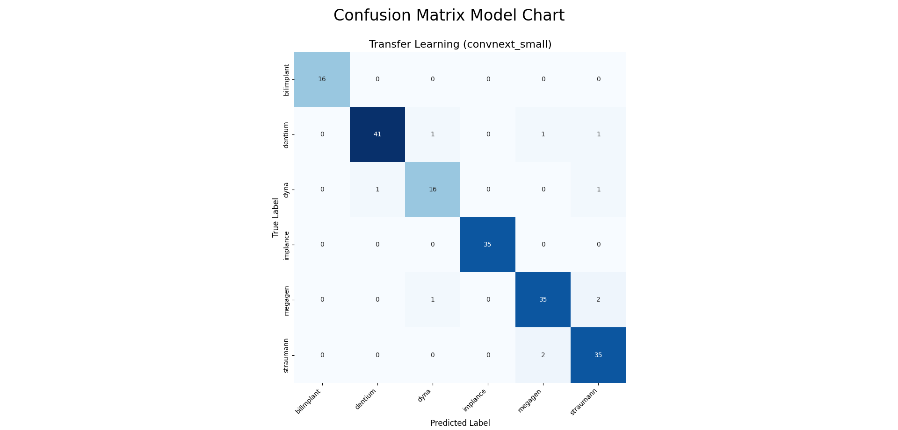

# Deep Learning for Dental Implant Brand Detection & Classification

[](https://dental.mlubbad.com)
[](https://doi.org/10.1007/s10278-024-01086-x)
[](https://doi.org/10.1016/j.jormas.2024.101818)
[](LICENSE)

Research overview, baseline training scripts, experimental benchmarks, and aggregate evaluation figures from the PhD dissertation of **Dr. Mohammed A. H. Lubbad** (Department of Computer Engineering & Artificial Intelligence and Big Data Application and Research Center, **Erciyes University**, Kayseri, Türkiye — supported by **TÜBİTAK Project 121E068**).

---

## Interactive Research Demo

> **Live Web Evaluation Portal (English · العربية · Türkçe):** [**https://dental.mlubbad.com**](https://dental.mlubbad.com)  
> Explore **Scaled ConvNeXt** interactively with Grad-CAM visual explainability and multi-implant panoramic ROI analysis. *For research, academic, and clinical decision-support demonstration purposes only — not a certified standalone medical device.*

### Model & Collaboration Notice
Trained **Scaled ConvNeXt** checkpoints and inference services are **not publicly redistributed** in this repository. For academic collaboration, multi-center clinical validation, or custom institutional research inquiries, contact Dr. Mohammed Lubbad at [**mlubbad.com/contact**](https://mlubbad.com/contact/).

---

## Overview

Identifying the exact manufacturer and system of an existing dental implant from panoramic radiographs is essential for managing mechanical or biological complications, because each brand uses distinct abutment connections and screwdrivers.

This research systematically benchmarks **28+ modern deep learning architectures** — spanning **Convolutional Neural Networks (CNNs)** and **Vision Transformers (ViTs)** — on a clinician-annotated dataset of **1,258 panoramic radiographs (6,586 labeled dental implants)** covering **6 major implant brands**, and introduces **Scaled ConvNeXt**, a parameter-efficient architecture that reduces parameter count by **>10 million parameters** (36.28M vs. 49.46M baseline) while achieving **95.74% published classification accuracy** (**96.83%** on the held-out test split).

---

## Key Publications & Mandatory Dataset Citation

1. **Mohammed A. H. Lubbad**, I. Leblebicioglu Kurtulus, D. Karaboga, K. Kilic, A. Basturk, B. Akay, O. U. Nalbantoglu, O. M. Durmaz Yilmaz, M. Ayata, S. Yilmaz, and I. Pacal (2024).  
   **"A Comparative Analysis of Deep Learning-Based Approaches for Classifying Dental Implants Decision Support System."**  
   *Journal of Imaging Informatics in Medicine* (Springer).  
   DOI: [`10.1007/s10278-024-01086-x`](https://doi.org/10.1007/s10278-024-01086-x)

2. I. Leblebicioglu Kurtulus, **Mohammed Lubbad**, O. M. Durmaz Yilmaz, D. Karaboga, A. Basturk, B. Akay, U. Nalbantoglu, K. Kilic, M. Ayata, I. Pacal, and S. Yilmaz (2024).  
   **"A robust deep learning model for the classification of dental implant brands."**  
   *Journal of Stomatology, Oral and Maxillofacial Surgery*, 101818 (Elsevier).  
   DOI: [`10.1016/j.jormas.2024.101818`](https://doi.org/10.1016/j.jormas.2024.101818)

3. **Dataset Reference (Required Attribution):**  
   **Erciyes University Dental Implants Dataset (121E068)**, Ikbal Leblebicioglu Kurtulus, Dervis Karaboga, Bahriye Akay, Alper Basturk, Ozkan Ufuk Nalbantoglu, Ozden Melis Durmaz Yilmaz, Kerem Kilic, Serkan Yilmaz, *Technical Report*, 2023.

---

## Dataset Summary & Data Privacy / Compliance Notice

Panoramic radiographs were acquired at the **Erciyes University Faculty of Dentistry (2012–2023)** under **Ethics Committee Approval `2021/234`**, fully anonymized and annotated by specialist prosthodontists and dentomaxillofacial radiologists.

| Implant Brand | Panoramic Images (n) | Labeled Implants (n) | Train (Orig / Aug) | Val (Orig / Aug) | Test |
|---|---:|---:|---:|---:|---:|
| **Straumann** | 106 | 1,203 | 174 / 345 | 37 / 37 | 37 |
| **Bilimplant** | 121 | 1,144 | 74 / 364 | 16 / 32 | 16 |
| **Implance** | 236 | 2,150 | 166 / 326 | 35 / 36 | 35 |
| **Dyna** | 248 | 340 | 85 / 335 | 18 / 36 | 18 |
| **Megagen** | 253 | 871 | 177 / 353 | 38 / 38 | 38 |
| **Dentium** | 294 | 878 | 206 / 411 | 44 / 44 | 44 |
| **Total** | **1,258** | **6,586** | **882 / 2,134** | **188 / 223** | **188** |

> **Strict Data Privacy, HIPAA, KVKK & License Compliance:**  
> - **Zero patient data or radiographs** (no raw X-rays, no thumbnails, no DICOM headers, no Protected Health Information / PHI, and no patient identifiers) are included anywhere in this repository.  
> - Only aggregate published statistics, confusion matrices, and generic PyTorch baseline scripts are shared.  
> - The **Erciyes University Dental Implants Dataset (121E068)** is owned by Erciyes University, restricted to non-commercial academic research within Türkiye under the **ERU Dataset License Agreement**, Ethics Committee Approval `2021/234`, KVKK, and Presidential Circular `2019/12` (Official Gazette No. 30823). Requests for dataset access must be submitted directly to the Department of Computer Engineering, Erciyes University, Kayseri, Türkiye.

---

## Benchmark Summary (300 Epochs, SGD + Augmentation)

| Model Architecture | Parameters | Test Accuracy | Precision | Recall | F1-Score |
|---|---:|---:|---:|---:|---:|
| **Scaled ConvNeXt (Proposed)** | **36.28M** | **95.74%** | **96.01%** | **94.72%** | **95.22%** |
| Swin-Base (`patch4_window7_224`) | 86.75M | 95.74% | 96.04% | 95.14% | 95.44% |
| Swin-S3-Small (`224`) | 49.60M | 95.21% | 94.81% | 93.06% | 93.70% |
| ConvNeXt-Small (Baseline) | 49.46M | 94.68% | 95.22% | 94.32% | 94.71% |
| ConvNeXt-Tiny | 27.82M | 94.68% | 94.74% | 94.22% | 94.46% |
| MaxViT-Large (`224`) | 210.77M | 94.68% | 95.95% | 93.12% | 94.13% |
| RegNetY-32GF | 141.36M | 93.60% | 92.80% | 92.80% | 92.80% |
| RegNetY-16GF | 80.58M | 93.40% | 92.40% | 93.00% | 92.70% |
| DenseNet-121 | 6.96M | 93.20% | 93.40% | 91.60% | 92.20% |
| VGG-16 | 134.29M | 92.55% | 93.21% | 90.46% | 91.82% |
| EfficientNet-B4 | 19.34M | 92.40% | 92.40% | 90.80% | 91.60% |
| ViT-L/16 | 303.30M | 92.02% | 93.80% | 90.07% | 91.32% |

### Confusion Matrix — Scaled ConvNeXt


---

## Repository Structure

```text
dental-implant-dl-classification/
├── src/
│   ├── baselines/     # Dataset splitting, augmentation, & standard baseline CNN training scripts
│   ├── dnnlab/        # Standard PyTorch benchmark scripts across 21 CNN & ViT architectures
│   └── analysis/      # Evaluation utilities and accuracy plotting scripts
├── results/           # Aggregate published dataset distribution CSV
├── figures/           # Aggregate confusion matrix plots (zero patient imagery)
├── requirements.txt   # Core Python / PyTorch / timm dependencies
└── LICENSE            # MIT License (baseline research scripts only)
```

---

## Citation

```bibtex
@article{lubbad2024comparative,
  title={A Comparative Analysis of Deep Learning-Based Approaches for Classifying Dental Implants Decision Support System},
  author={Lubbad, Mohammed A. H. and Kurtulus, Ikbal Leblebicioglu and Karaboga, Dervis and Kilic, Kerem and Basturk, Alper and Akay, Bahriye and Nalbantoglu, Ozkan Ufuk and Yilmaz, Ozden Melis Durmaz and Ayata, Mustafa and Yilmaz, Serkan and Pacal, Ishak},
  journal={Journal of Imaging Informatics in Medicine},
  year={2024},
  publisher={Springer},
  doi={10.1007/s10278-024-01086-x}
}

@article{kurtulus2024robust,
  title={A robust deep learning model for the classification of dental implant brands},
  author={Kurtulus, Ikbal Leblebicioglu and Lubbad, Mohammed and Yilmaz, Ozden Melis Durmaz and Karaboga, Dervis and Basturk, Alper and Akay, Bahriye and Nalbantoglu, Ufuk and Kilic, Kerem and Ayata, Mustafa and Pacal, Ishak and Yilmaz, Serkan},
  journal={Journal of Stomatology, Oral and Maxillofacial Surgery},
  pages={101818},
  year={2024},
  publisher={Elsevier},
  doi={10.1016/j.jormas.2024.101818}
}

@techreport{kurtulus2023eru121e068,
  title={Erciyes University Dental Implants Dataset (121E068)},
  author={Kurtulus, Ikbal Leblebicioglu and Karaboga, Dervis and Akay, Bahriye and Basturk, Alper and Nalbantoglu, Ozkan Ufuk and Yilmaz, Ozden Melis Durmaz and Kilic, Kerem and Yilmaz, Serkan},
  institution={Erciyes University},
  year={2023}
}
```
